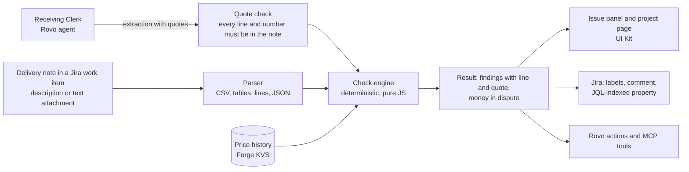

<h1>
  <picture>
    <source media="(prefers-color-scheme: dark)" srcset="docs/brand/lockup-reversed.svg">
    
  </picture>
</h1>

Delivery note control inside Jira, for restaurants and anyone else who signs for goods at the back door.

Dockside reads a supplier's delivery note (in Spain, the *albarán*), checks it against the price you last approved for each item, what you ordered, what was counted at the door, the Spanish VAT rates and the note's own arithmetic, and tells you exactly which line is wrong and how much money is at stake. A Rovo agent, the Receiving Clerk, reads the messy notes the parser can't, and every line it extracts is verified against the original before it counts.

Install link for judges: `INSTALL_LINK_PENDING` (see "Install" below)
Video: `VIDEO_LINK_PENDING`

## The problem

A restaurant gets a delivery note with almost every delivery. Someone signs it at the kitchen door between two other jobs. Over a month the small things add up: the hake's 70 cents a kilo dearer than last time, 2 kilos of mussels arrive that nobody ordered, butter's billed for 10 kilos when 8 came off the van, eggs are charged at 7% VAT, and the same note gets booked twice because it came by email and on paper.

None of this is hard to catch. It just needs someone to compare every line with the last price and the order, every time, and nobody's got time for that at 7:40 in the morning. I built Dockside so the comparison happens on its own, in the tool the team already uses to track work, and so you get something you can act on: approve it, or send the supplier a list of what to credit.

## What it does

- Turns pasted notes into lines: CSV with commas or semicolons, tables copied from a PDF (pipes or aligned columns), simple lines like `15 kg Onions @ 0,92 = 13,80`, or JSON. Spanish and English headers, decimal commas or dots. Text attachments (.txt, .csv, .json) work too.
- Checks each line: price against the reference (the agreed price list if there is one, otherwise the last approved note for that item), over-delivery against the order, goods billed but not counted at the door, short deliveries, line arithmetic, VAT rate against the Spanish rates (4, 10, 21%) and against what the supplier charged last time.
- Checks the note: subtotal, VAT and total against the lines, missing totals, items listed twice, and the same note number from the same supplier booked before.
- Gives one verdict per note (OK, Check, Dispute, Not read) and the money in dispute, VAT included, built line by line so a line the parser missed can't inflate it.
- It won't say OK without reading. A note with no readable lines is "Not read", and a note without a total is "Check".
- Keeps an audit trail: who checked, approved or disputed what, when, and through which surface (panel or agent).

## Try it in two minutes

1. Install Dockside on a Jira site (link above) and open any company-managed or team-managed project.
2. Open the Dockside tab in the project and press "Load demo data". It creates seven invented delivery notes from four invented suppliers, plus three months of price history. Each note has a known problem.
3. Open a note (for example "Delivery note RP-24117 from Pescados Rompeolas S.L."). In the work item, open the Dockside panel from the apps button. You will see the verdict, each finding with its line number and the quoted line, and the money in dispute.
4. Press Dispute. Dockside posts a draft letter to the supplier as a comment, from you, and keeps those prices out of the reference. Or press Approve, and those prices become the reference for the next note.
5. With Rovo on, press "Ask the Receiving Clerk" on the hand-typed note (Huerta Valdeluz, note 5560). The agent reads the line the parser could not, sends its extraction back to the engine, and the engine checks every quote and number against the note before using it.
6. Back on the project page: open findings across all notes, supplier price changes with a chart, suppliers, and the activity log.

Search with JQL too: `issue.property[dockside].amountInDispute > 0` or `issue.property[dockside].status = "DISPUTE"`.

## How it works



The model reads; the code decides. I kept the engine in `src/lib/` free of Forge and of randomness: the same note, history and settings always give the same answer, and that's what lets the tests below pin every figure to the cent. The Rovo agent only does the part a language model is good at, reading a hand-typed note, and I treat what it returns as a claim to check, not a fact.

It all runs on Atlassian. There's no external server, no egress and no third-party key, and the data stays in Forge storage for the installation.

## Forge modules and Atlassian APIs

| Module | What Dockside uses it for |
|---|---|
| `jira:issuePanel` (UI Kit) | The check result on each delivery note: verdict, findings, lines, Approve, Dispute, Ask the Receiving Clerk |
| `jira:projectPage` (UI Kit) | Overview of the project: money in dispute, open findings, price changes chart, suppliers, activity, settings, Load demo data |
| `trigger` on `avi:jira:created:issue` and `avi:jira:updated:issue` | Checks a note when it is created or edited, without anyone opening it (with `ignoreSelf` so its own writes never loop) |
| `jira:entityProperty` | Indexes the result (status, money in dispute, findings, supplier, decision) so it can be searched with JQL |
| `action` (7) | The tools the agent and MCP clients call: check, parse, price history, open findings, price changes, save extraction, record decision |
| `rovo:agent` | The Receiving Clerk, with a strict prompt: extract to a schema, never invent, quote every line, let the engine decide |
| `rovo:mcp` (Preview) | Exposes the five read-only tools to Rovo Studio agents and to external MCP clients |
| Forge KVS (`@forge/kvs`) | Price history per supplier and item, results, decisions, duplicate index, audit log, settings |
| `@forge/bridge` `rovo.open` | Opens the Receiving Clerk from the panel with the note already in the prompt |

Scopes and why each one is there:

| Scope | Used for |
|---|---|
| `read:jira-work` | Reading the work item, its attachments, the project and the user's permissions; required by the issue events |
| `write:jira-work` | Labels, comments, the indexed issue property, and creating the demo notes |
| `manage:jira-configuration` | Only the optional "Add Delivery note work type" button, which a Jira admin presses once |
| `storage:app` | Forge KVS |

Every Jira call keeps its route inline so `forge lint` can match it to these scopes; removing any of the three Jira scopes makes the linter fail on the exact lines that need it.

## Bonus prizes

I'm entering two bonus prizes.

Best Rovo agent. The app ships a `rovo:agent`, the Receiving Clerk, backed by 7 `action` modules. You can ask it "Which suppliers raised prices this month?" or "What's still in dispute?", have it check the note on the current work item, or hand it a note the parser can't read. Its extractions go back through `check-delivery-note`, which rejects any line whose quote isn't in the note or whose numbers aren't in the quote, so the agent can't invent a line or change a figure without it showing. Decisions stay with people: the agent records an approval or a dispute only when asked, through an `UPDATE` action that runs with the user's own permissions. The panel opens the agent with `rovo.open` and a prompt that already names the work item.

Best app with Atlassian MCP. The `rovo:mcp` module exposes 5 read-only tools: `check-delivery-note`, `parse-delivery-note`, `get-price-history`, `list-open-discrepancies` and `list-price-changes`. They're available to custom agents in Rovo Studio and, once a site admin turns on external exposure (Atlassian Administration, Apps, Sites, Connected apps, Dockside), to any MCP client at `https://mcp.atlassian.com/forge/<appId>`. A purchasing manager can ask their own AI client "which suppliers raised prices in KAN this quarter" and get an answer from the same engine, limited to what that person can see in Jira.

Permissions on the MCP path: tools first call Jira as the user (`asUser()`). Atlassian documents that user tokens can fail for some external clients, and when that happens Dockside doesn't fall back to app access blindly. It asks Jira, as the app, whether that exact account has Browse Projects on that project or work item (`POST /rest/api/3/permissions/check`) and refuses if it hasn't. I test both paths.

## Permissions and audit

- The issue panel and the project page take the work item and the project from the Forge context, never from the request, so a user cannot ask for someone else's data by changing a payload.
- Reads run as the user. Approving or disputing needs Edit work items in the project; changing rules needs project admin; adding the work type needs Jira admin.
- System writes after an automatic check (labels, the indexed property, one comment when the result changes) are made by the app and show as Dockside. Decisions are made as the person, and the dispute letter is posted in their name.
- Editing a note after it was approved clears the decision and removes its prices from the reference.
- Every new result, decision, setting change and agent extraction lands in an activity log with the account, the time and the surface. Each work item also keeps its own history of checks.

## Tests

`npm test` runs the whole suite: parser formats, every check, money to the cent on each demo note, agent extraction verification, and the whole app flow (load demo data, approve, dispute, edit after approval, permissions, the MCP fallback) against an in-memory Jira and KVS. The table below is produced by those tests.

<!-- scorecard:start -->
Generated by `npm run scorecard` from the test data. Do not edit by hand; `npm test` fails if this table and a fresh run disagree.

Demo notes, the seven that "Load demo data" creates:

| Note | Format read | Expected findings | Status | In dispute | Match |
|---|---|---|---|---|---|
| Hake price up and two kilos of mussels nobody ordered | csv | PRICE_ABOVE_REFERENCE, OVER_DELIVERY | DISPUTE | €16.06 | yes |
| Lettuce line does not add up and tomatoes charged at 10% VAT | pipe-table | VAT_RATE_CHANGED, LINE_TOTAL_MISMATCH | DISPUTE | €2.08 | yes |
| Drinks order, everything matches | json | none | OK | €0.00 | yes |
| Two kilos of butter billed but not delivered, eggs at 7% VAT | aligned-table | BILLED_NOT_RECEIVED, VAT_RATE_INVALID, VAT_TOTAL_MISMATCH | DISPUTE | €21.43 | yes |
| Same fish note sent again a few days later | csv | DUPLICATE_NOTE, PRICE_ABOVE_REFERENCE, OVER_DELIVERY | DISPUTE | €391.16 | yes |
| Hand-typed produce note, one line Dockside cannot read on its own | free-text | PRICE_ABOVE_REFERENCE, SUBTOTAL_MISMATCH, VAT_TOTAL_MISMATCH | DISPUTE | €2.18 | yes |
| Only a note that a photo was attached | unrecognised | UNREADABLE | UNREADABLE | €0.00 | yes |

Synthetic corpus: 120 notes from a fixed seed (20261102), 35 csv, 34 pipe-table, 17 aligned-table, 17 json, 17 free-text. One note in five is clean; the others carry one or two injected problems.

| Check | Injected | Found | Missed | False flags |
|---|---|---|---|---|
| Price above reference (`PRICE_ABOVE_REFERENCE`) | 19 | 19 | 0 | 0 |
| More than ordered (`OVER_DELIVERY`) | 4 | 4 | 0 | 0 |
| Short delivery (`SHORT_DELIVERY`) | 10 | 10 | 0 | 0 |
| Billed but not received (`BILLED_NOT_RECEIVED`) | 8 | 8 | 0 | 0 |
| Line total does not add up (`LINE_TOTAL_MISMATCH`) | 12 | 12 | 0 | 0 |
| Invalid VAT rate (`VAT_RATE_INVALID`) | 13 | 13 | 0 | 0 |
| VAT rate changed (`VAT_RATE_CHANGED`) | 11 | 11 | 0 | 0 |
| VAT total does not add up (`VAT_TOTAL_MISMATCH`) | 13 | 13 | 0 | 0 |
| Subtotal does not add up (`SUBTOTAL_MISMATCH`) | 8 | 8 | 0 | 0 |
| Total does not add up (`TOTAL_MISMATCH`) | 13 | 13 | 0 | 0 |
| No total to check (`MISSING_TOTALS`) | 12 | 12 | 0 | 0 |
| Duplicate delivery note (`DUPLICATE_NOTE`) | 8 | 8 | 0 | 0 |
| Item listed twice (`DUPLICATE_LINE`) | 13 | 13 | 0 | 0 |
| All checks | 144 | 144 | 0 | 0 |

Clean notes marked OK: 24 of 24. Notes where every finding was right and nothing extra was flagged: 120 of 120.

What this does and does not show: the corpus is generated by the same project, so it proves the parser and the checks hold up across formats, decimal styles, Spanish and English headers and mixed problems. It says nothing about accuracy on real suppliers' paperwork, which I have not measured.
<!-- scorecard:end -->

Other checks that run without logging in to Forge:

- `npm run validate`: full manifest validation with `@forge/manifest` plus the client-side `forge lint` rules, including scope checks for every Jira endpoint the code calls.
- `npm run bundle-check`: builds the backend and both UI Kit resources with the Forge CLI's own bundlers.
- `npm run check-imports`: every import from `@forge/*` exists in the installed version.

## Limits

- Dockside reads text. It does not do OCR on photos or PDFs; paste the text, attach a .txt/.csv/.json, or let the Receiving Clerk read it.
- VAT rules are Spain's three rates plus "same rate as last time". It flags, it does not give tax advice.
- The price rule is one threshold per project (3% by default) against the last approved price or an agreed price list.
- Jira can deliver issue events up to three minutes late. The panel checks again when it opens if the note changed, so nobody waits for the trigger.
- `rovo:mcp` is in Preview and external MCP exposure has to be switched on by a site admin.
- All demo data is invented. Supplier names, items, prices and note numbers are synthetic and do not come from any real business.

## Install

For judges: open the install link at the top, choose your Jira site and accept. Then follow "Try it in two minutes". Rovo features need Rovo to be on in the site; everything else works without it.

For developers:

```bash
npm ci
npm test
npx forge register      # once, gives the app its own id
npx forge deploy
npx forge install       # pick Jira and your site
```

The Forge CLI needs Node.js 22.23.4+, 24.22.1+ or 26.12.1+.

## Licence

MIT

The logo (the loading door with a crate crossing it) is in `docs/brand/` and in `static/assets/`. The name in the lockup is Barlow Semi Condensed SemiBold (SIL Open Font License 1.1), converted to outlines, so no font file ships with the app.
